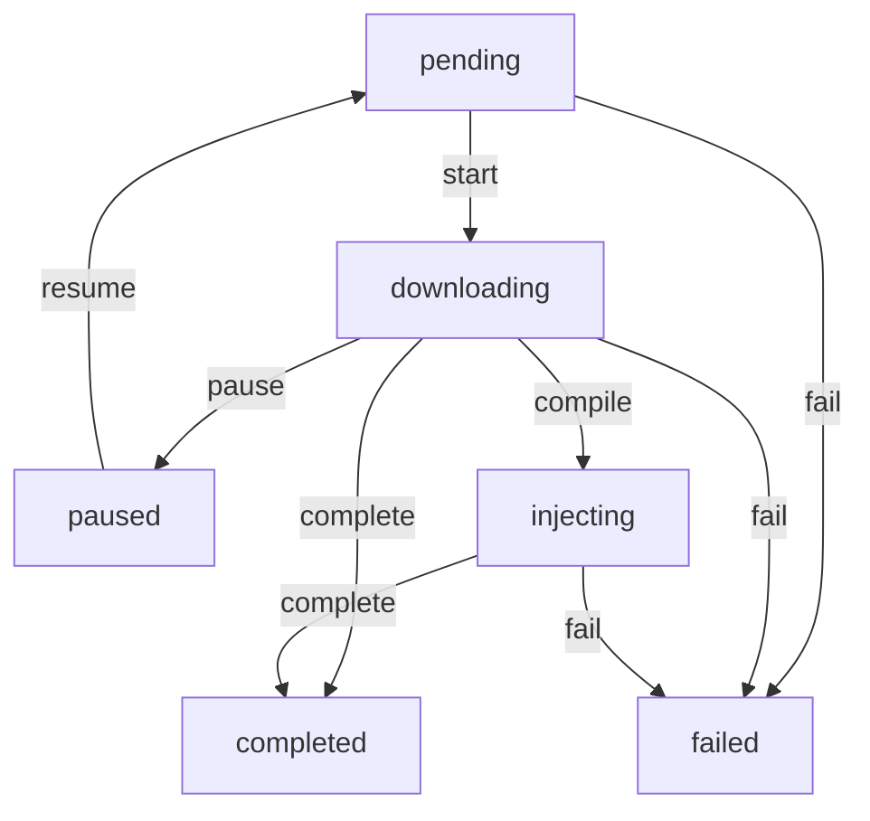

# AssppWeb：規格優先驗證與修正紀錄

本輪基準：`28cb57f669bcf86687b2e0dd7591b41a976fde4b`，2026-11-24。

這份文件區分三件事：Lean 在明確模型下證明的性質、正式程式與模型之間的差異驗證，以及仍需整合測試或外部服務確認的行為。**沒有宣稱整個瀏覽器、Apple 協定、密碼學或 Cloudflare 平台都已形式化證明。**

## 1. 架構與驗證邊界

AssppWeb 的使用者動作跨越三種執行環境：

| 環境                   | 負責的工作                                                               | 關鍵邊界                                                                               |
| ---------------------- | ------------------------------------------------------------------------ | -------------------------------------------------------------------------------------- |
| 瀏覽器                 | SAP 簽章、Apple 登入／驗證碼、授權、下載資訊、帳號與裝置狀態             | Apple 密碼、驗證碼、cookie、token、完整登入本文及 SAP 狀態留在瀏覽器；TLS 經 Wisp 傳輸 |
| Node.js 後端           | 公開 bag／目錄代理、Wisp、IPA 下載與編譯、持久化索引、提供下載／安裝資訊 | 接受下載 URL、SINF／metadata；不能把 HTTP 200 當成 Apple 授權成功                      |
| Go device-proof helper | 裝置證明與短期 provisioning context                                      | loopback、嚴格欄位白名單、單次使用 handle、到期與取消、無帳號憑證                      |

本輪沒有全面重寫上述環境。先對現有實作建立反例，將可純化的關鍵決策寫成 Lean 可執行規格，再讓正式 TypeScript／Go 呼叫對應政策函數。檔案系統、網路與 UI 的非同步行為另外用故障注入與競爭測試驗證。

### 規格與實作對照

| Lean 定義（`formal/Asspp.lean`） | 正式實作                                | 使用位置                                                                       |
| -------------------------------- | --------------------------------------- | ------------------------------------------------------------------------------ |
| `transitionDownload`             | `backend/src/domain/downloadPolicy.ts`  | 下載管理器 start、pause、resume、compile、complete、fail、delete、deleteFailed |
| `acceptChunk`                    | 同上                                    | Range 標頭接收與串流結束後的實際長度檢查                                       |
| `decideDownloadResponse`         | `frontend/src/domain/downloadPolicy.ts` | Apple 下載端點回退及最終 items 接受                                            |
| `decideAuthResponse`             | `frontend/src/domain/authPolicy.ts`     | AMD／redirect 處理後的登入回應判斷                                             |
| `decideProvisionFinish`          | `proof-helper/provision_policy.go`      | Go helper 在執行 native finish 前的 handle 判斷                                |

`formal/Main.lean` 直接呼叫這些 Lean 定義輸出 oracle。TypeScript 驗證器匯入正式政策模組，Go 測試呼叫正式函數；兩者都讀取同一份當次生成的 oracle，沒有另外維護一份手寫預期結果。

## 2. 已證明的性質

使用官方原生 **Lean 4.36.0**，固定在 `formal/lean-toolchain`。模型只依賴標準函式庫，沒有 Mathlib 或第三方狀態機框架。共 35 個 theorem，由 Lean 核心檢查；`formal/Assurance.lean` 列印每個 theorem 的依賴，閘門要求所有 theorem 都出現在依賴稽核中。

### 下載生命週期



刪除事件可由任何狀態進入 `deleted`。為保持圖面可讀，此共通轉移未在每個節點重複畫線。`deleted` 是模型的墓碑狀態；正式實作會移除任務 Map 項目，不把墓碑持久化成新的公開任務狀態。

已證明：

- 非當前 generation 的 worker 事件不改變狀態。
- `deleted` 對任何事件都保持 `deleted`，且對**任意長度事件序列**都成立。
- worker 事件不能使已完成或已暫停任務改變狀態。
- delete 一定進入墓碑狀態。
- 除已處於 completed 的冪等情形，完成只能來自當前 generation 的 downloading／injecting。
- 正常 start → compile → complete，以及 pause → resume 後的指定成功事件序列都會到達 completed。這些是給定事件的可達性，不是外部網路一定成功的活性保證。

`currentGeneration` 的實作來源是任務物件仍屬於 Map，且執行符號仍是該任務目前的 run。Lean 證明布林條件給定後的轉移；實際物件／符號判斷與非同步清理由 stale callback、pause/resume/delete、編譯後刪除等回歸測試支撐。

### 分段下載接受條件

只有以下條件同時成立才能接受一段內容：HTTP 206、可解析的 Content-Range、要求範圍有效、實際起點／終點／總長完全相符，以及實際位元組數等於 `end - start + 1`。數字須在 JavaScript 安全自然數範圍內。

已證明接受結果具有精確欄位與長度、範圍有效、HTTP 200 不會被當作 Range 成功、截短內容不會被接受。這是範圍與長度完整性，**不等於對 IPA 內容的密碼學雜湊或 Apple 身分驗證**。

也證明所有滿足完整契約與安全整數條件的分段會被接受，包含一個非零起點的中段範例，避免把「永遠拒絕」誤認為符合所有安全要求。

字串解析、NaN、Infinity、負數、分數與不安全整數在 TypeScript 邊界另行測試；它們不是 Lean `Nat` 的值。

### Apple 登入與下載回應

已證明 dialog、action、拒絕狀態、畸形結構等條件的優先順序。下載 items 必須伴隨沒有失敗／錯誤訊息的有效回應；HTTP 正常與 token、DSID 缺一不可，才可能得到 authenticated。`-5000` 的特殊憑證重試只可發生在 firstAttempt。

正向性質涵蓋乾淨登入成功、有效下載 items 被接受，以及授權不可用但只有一般訊息的既有回退流程。

模型中的下載 `status` 是 **plist 本文欄位**。HTTP 狀態、AMD／redirect、空本文白名單回退、原始 plist 到分類欄位的投影，以及 app／bundle／版本綁定，仍在實作與整合測試層。為維持 pinned ipatool 相容性，已辨識的非 HTTP 200 憑證／驗證碼延續保留原行為；沒有把「所有延續都必須 HTTP 200」寫成不存在的保證。

### Provisioning handle

已證明只有存在、裝置相符、未過期且 context 未取消的 handle 可以 consume；consume 後不能重播；錯誤裝置不能消耗另一裝置的有效 handle。

另有正向性質確認有效 handle 確實會被 consume。

實作在 native 進入前與返回後重新檢查到期／取消。HTTP caller 的取消另有 admission 檢查。這些檢查由 Go race 測試涵蓋；模型沒有聲稱 handle 能在網路上恰好送達一次，也沒有聲稱任意 native 函數一定會及時回應取消。

## 3. 差異驗證與異變驗證

每次 `npm run verify:formal` 都重新檢查模型、生成 oracle，並比較：

| 範圍                 |     輸入數 | 覆蓋方式                                    |
| -------------------- | ---------: | ------------------------------------------- |
| 下載生命週期         |        112 | 7 狀態 × 8 事件 × 2 generation 情形，全列舉 |
| 下載回應政策         |        576 | 所有抽象欄位組合，全列舉                    |
| 登入回應政策         |      3,072 | 所有抽象欄位組合，全列舉                    |
| Go provisioning 政策 |         16 | 4 個布林欄位，全列舉                        |
| HTTP Range 接受政策  |     48,645 | 小範圍完整列舉與逐欄位變異，加上大整數邊界  |
| 合計                 | **52,421** | 當次 Lean 輸出與正式程式比對                |

另有 42 個 JavaScript 數字表示邊界檢查。Range 的測試集合是有限的；任意自然數的模型性質來自 theorem，而不是從 48,645 個案例推論出來。

11 個定向異變刻意移除 generation 防護、重啟 completed、接受 HTTP 200／短段／錯誤總長、忽略下載／登入拒絕訊號、接受矛盾 items、允許缺 DSID、取消 firstAttempt 限制。每個異變都必須被 oracle 找到反例；檢查器也先驗證未改動模組通過，避免把載入失敗當成抓到異變。這是指定決策保護的異變驗證，沒有宣稱整個專案的異變分數是 100%。

此外，`scripts/formal-proof-mutations.mjs` 在暫存目錄直接修改 Lean 模型，分別移除舊 worker 防護與登入拒絕狀態判斷。原模型必須成功編譯，兩個異變都必須因無法完成證明而失敗；語法或工具環境錯誤不算成功抓到異變。這兩個檢查也包含在正式閘門內。

## 4. 本輪確認並修正的問題

| 編號  | 原有問題／反例                                                                                   | 修正與驗證位置                                                                               |
| ----- | ------------------------------------------------------------------------------------------------ | -------------------------------------------------------------------------------------------- |
| AV-01 | 5002 或成功 items 掩蓋 dialog、action、拒絕狀態、密碼變更或終止型 metrics                        | 統一下載政策；`downloadProduct.test.ts`、`downloadModern.test.ts`                            |
| AV-02 | 登入 token／DSID、-5000 或驗證碼訊息與拒絕資訊同時存在仍繼續                                     | 統一登入政策；`authenticate.test.ts`、`authenticateRetry.test.ts`                            |
| AV-03 | falsy／錯誤型別的 status、failure、dialog、action 被視為缺省／成功                               | 明確的 response shape 投影與前端政策測試                                                     |
| AV-04 | helper headers 到達後清除 timer，body 卡住可長期持有裝置／帳號鎖                                 | deadline 包含 JSON body，晚到結果不寫回；`storeProof.test.ts`                                |
| AV-05 | Range 被忽略、標頭矛盾、回應截短／超長仍完成；單串流接受 HTTP 206 或截短內容                     | 精確範圍／位元組檢查與串流取消；`chunkIntegrity.test.ts`                                     |
| AV-06 | package DELETE 直接刪檔，背景編譯可使任務／檔案重新出現                                          | 刪除統一走 downloadManager generation／任務政策；`downloadStateMachine.test.ts`              |
| AV-07 | tasks.json 直接覆寫；索引損壞導致既有完整 IPA 被當 orphan 刪除                                   | flush 暫存檔＋同目錄 rename；保留無索引的完整 IPA；相關啟動／寫入故障測試                    |
| AV-08 | 已釋放檔案但索引寫入失敗時，空間清理可能繼續多刪另一個套件                                       | 以實際任務／檔案移除結果計算已釋放空間                                                       |
| AV-09 | 檔案在 stat/open 間或讀取中消失，造成未處理 stream error／懸掛回應；不存在的檔案仍可取得安裝資訊 | 共用安全串流函數、完整終態紀錄與安裝檢查；`packageServing.test.ts`                           |
| AV-10 | 只有 iTunesMetadata、沒有 SINF 時跳過編譯                                                        | 任一資料存在就進入 injecting；下載生命週期回歸測試                                           |
| AV-11 | 已取消／過期 provisioning context 仍呼叫 native Finish；到期後仍可能發布結果                     | native 前後邊界檢查、單次消耗／關閉；`provision_boundary_test.go`                            |
| AV-12 | 搜尋／lookup 把 Apple HTTP 429／500 或錯誤 wrapper 當成成功空結果                                | HTTP 與結果結構驗證，固定 502 錯誤；`catalogRoute.test.ts`                                   |
| AV-13 | 目錄請求沒有總期限，bag 的 inactivity timeout 可被小量資料持續延長                               | fetch／DNS／TLS／body 共用 15 秒總期限，斷線取消；`catalogRoute.test.ts`、`bagRoute.test.ts` |
| AV-14 | helper proxy 預先拒絕過大 Content-Length 後，未消耗的回應可能繼續傳輸                            | finally 取消上游請求；`storeProofRoute.test.ts`                                              |

每項修正保留既有安全診斷欄位與 flow ID。新增錯誤不輸出 Apple 原始回應、帳號憑證、opaque proof 或 native buffer。診斷與執行結果分開，不會因為記錄成功就宣稱協定成功。

## 5. 全專案盤點覆蓋

| 路徑                               | 本輪覆蓋                                                             | 仍需承認的界線                                         |
| ---------------------------------- | -------------------------------------------------------------------- | ------------------------------------------------------ |
| 登入／2FA／RP／SP／redirect／retry | 回應決策形式化＋既有與新增協定回歸測試                               | Apple 回應與實際帳號接受度、SAP 與原生演算法           |
| 授權／已擁有／條款／地區拒絕       | 原有 purchase 測試重跑、回退錯誤優先順序檢查                         | 真實地區可用性、Apple 對網路出口的判斷                 |
| 下載資訊與版本綁定                 | 回應分類形式化＋端點鏈與版本測試                                     | HTTP 與 plist 投影本身不是自動抽取的 Lean 精化證明     |
| 帳號／裝置資料與 reset             | 審閱 IndexedDB、同帳號／裝置鎖、跨分頁 Web Locks、stale write 測試   | 瀏覽器儲存引擎與 Web Locks；多個儲存區清除不是單一交易 |
| 搜尋／lookup／國家切換             | 上游 HTTP／結果結構／期限／斷線回歸測試，結果 revision／國家選擇測試 | 外部目錄可用性與資料內容                               |
| 後端下載／暫停／恢復／刪除         | 生命週期與 Range 政策形式化＋串流、競爭、儲存故障測試                | OS 排程、磁碟／斷電、內容身分與雜湊                    |
| SINF／metadata／套件與安裝         | injector、metadata-only、檔案不存在／串流失敗測試                    | 真實 iOS 安裝與裝置授權                                |
| Helper HTTP／native boundary       | handle 政策形式化＋Go race、嚴格輸入、大小、逾時、日誌測試           | 上游原生執行引擎、Apple machine provisioning           |
| 日誌／Wisp／API 存取保護           | 既有 allowlist、safe logging、無敏感輸出與 access token 測試         | 部署來源可信度、TLS／WASM／瀏覽器實作                  |
| Docker／Cloudflare                 | 必經驗證 stage、官方工具鏈雜湊固定、既有自動建置設定保留             | 完整映像建置與實際 rollout 是不同驗收步驟              |

完整 IPA 若失去索引，現在會保留供人工復原或移除；系統不會憑空補出遺失的帳號／軟體 metadata。索引使用 flush＋同目錄 rename，沒有宣稱多檔案、跨檔案系統或斷電情況的完整交易性。

## 6. 重現命令

先安裝 lockfile 固定的 Node 相依項目、官方 Lean 4.36.0 與 Go（原生上游 build 使用 1.26.5）：

```bash
npm ci
npm --prefix frontend ci
npm --prefix backend ci
npm run verify
```

工具不在 PATH 時，可以指定執行檔，不能用這些選項跳過步驟：

```bash
ASSPP_LEAN=/path/to/lean-4.36.0/bin/lean \
ASSPP_GO=/path/to/go/bin/go \
npm run verify
```

只跑形式化與差異／異變閘門：`npm run verify:formal`。

只跑 Go HTTP service 與 policy 的標準函式庫 race 測試：`npm run test:helper`。這會測試正式 server／validation／policy 程式，只用 mock 取代 native runtime。包含原生 adapter 的 module test／build，仍依 [helper 說明](../proof-helper/README.md) 在 pinned ipatool module 內執行。

成功時 `formal/.lake/verification/verified.json` 記錄工具版本、來源與 oracle 雜湊；`assurance.txt` 記錄 theorem 依賴。這些檔案每次重建，不提交預先算好的 oracle。失敗會移除舊成功收據；缺少 Lean、錯誤版本、少測試、跳過 Go 對照、差異或異變存活都會失敗。

### 建置與發布

Docker 的 runtime 必須複製 verification stage 的成功收據，所以 BuildKit 不能把該 stage 當作未使用而省略。此閘門使用現有 `./Dockerfile`，Cloudflare Workers Builds 不需要新增 GitHub Actions。編譯器與測試工具只留在 build stage，runtime 只增加 `/app/formal-verification.json`。

第一次無快取建置會多下載約 608 MB 的官方 Lean 壓縮檔；後續可重用工具鏈層。工具鏈下載或驗證失敗時會停止建置，不會悄悄跳過證明。原有 main 自動建置觸發設定保留。

**建置通過不等於線上新映像已就緒。** 合併／部署後仍應依 [observability.md](observability.md) 確認 image、helper health、實際執行個體與同一 flow 的診斷；真實登入／取得授權／下載／iOS 安裝需在使用者自己的瀏覽器驗收。

## 7. 本次執行與尚未完成的整合驗收

本機使用 Node.js 24.22.3、官方 Lean 4.36.0 與 Go 1.26.5；Docker 的既有執行環境仍為 Node.js 22。驗證結果如下：

| 項目                       | 結果                                                                |
| -------------------------- | ------------------------------------------------------------------- |
| 前端 Vitest                | 542 個測試，35 個檔案，全部通過                                     |
| 後端 Vitest                | 214 個測試，16 個檔案，全部通過                                     |
| TypeScript 與正式 build    | 前端型別檢查、前端與後端建置通過                                    |
| Go HTTP service race tests | 19 個頂層測試，另有 10 個 credential-field 子測試；含實際 Lean 對照 |
| Lean                       | 35 個 theorem、完整依賴稽核與可執行 oracle                          |
| 差異與邊界                 | 52,421 組模型／正式政策比較，另有 42 組 JavaScript 數字表示檢查     |
| 指定異變                   | 11 個正式政策異變及 2 個 Lean 模型異變皆須被拒絕                    |

最後一輪完整 `npm run verify` 於 2026-11-24 16:25（台北時間）以 exit 0 完成。成功收據包含 223 個來源檔案的雜湊；當次 oracle 的 SHA-256 為 `caf989ce8fc59a0ee99caf17376b30d0f6451a81b0094ab1d59336b5ff1187a8`。

另外，在 pinned ipatool revision `3b02b4c55576562f2a55284cda9db9a4411d3067` 的完整 module 中，`go test -race -count=1 ./tools/asspp-proof` 與 `go build` 均通過，確認真實 native adapter 相依項目的編譯相容性。此獨立 module 執行沒有讀取 oracle；Lean comparator 由上述正式閘門另行強制執行並通過。

真實 Chromium smoke test 曾嘗試啟動，但瀏覽器在載入頁面前因執行環境禁止 Unix socket 而終止（`socket() failed: Operation not permitted`）。因此不把 jsdom 測試當成瀏覽器端到端通過，也沒有生成成功瀏覽器截圖。

本環境沒有 Docker engine，未完成完整映像建置；Docker stage 相依關係已靜態審閱，組成閘門的測試與編譯命令已在本機執行。正式 Node.js 22 映像、Cloudflare rollout，以及真實 Apple 登入／授權／下載／iOS 安裝仍是合併發布後需要確認的整合驗收。

## 8. 後續修改規則

1. 先修改 `formal/Asspp.lean` 的模型與要成立的性質；需要反例時，先加入回歸測試。
2. 政策欄位或狀態／事件有變化時，同步修改 oracle 列舉及完整性計數。
3. 調整正式政策與呼叫點；不要新增繞過政策的成功分支。
4. `npm run verify` 通過後再提交。保留不確定 purchase／enqueue 不自動重播的規則。
5. 若外部 Apple 行為不符合模型，先檢查分類／假設是否錯誤；不要為了讓測試通過就刪掉拒絕條件或放寬 theorem。

參考流程採用 [Cedar 的 verification-guided development](https://docs.cedarpolicy.com/other/security.html)：可執行模型、機器檢查的性質、正式實作與差異測試。其理念適用於這些決策核心；本專案沒有直接把 TypeScript／Go 自動轉換成 Lean 的工具鏈，因此不稱為全程已證明的編譯或自動精化。
